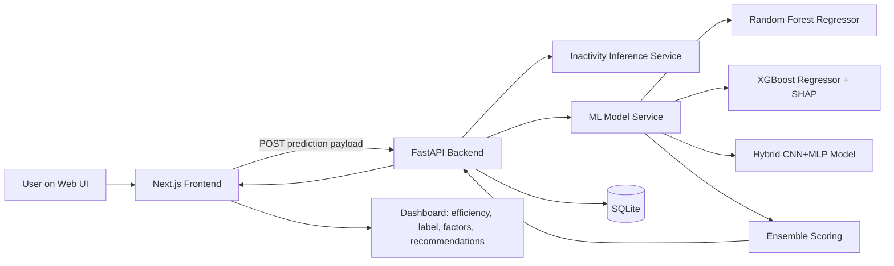

# System Architecture

## Prediction Flow
1. Frontend collects lifestyle features and browser interaction events.
2. Interaction events are transformed into a 288-length 5-minute activity sequence.
3. Backend infers probable sleep start from a >=30-minute evening inactivity window.
4. Engineered features are created from lifestyle + inactivity-derived features.
5. RF, XGBoost, and Hybrid models predict sleep efficiency.
6. Ensemble output determines final sleep efficiency and Good/Poor label.
7. SHAP local contributions from XGBoost produce top influencing factors.
8. Rule-based recommendation generator creates actionable suggestions.
9. Prediction record is persisted in SQLite and returned to UI.

## Database Schema
Table: `predictions`
- `id` (PK)
- `created_at`
- `input_payload` (JSON)
- `inferred_sleep_time` (HH:MM)
- `predicted_efficiency` (float)
- `predicted_quality` (`Good`/`Poor`)
- `model_outputs` (JSON: rf/xgb/hybrid/ensemble)
- `top_factors` (JSON)
- `recommendations` (JSON)
