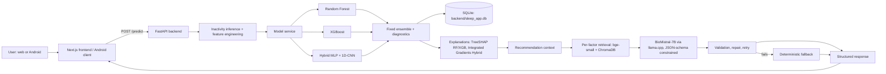

# System Architecture

## Prediction and Recommendation Flow
1. The client sends 13 lifestyle inputs and a binary 288-bin activity sequence. The web client records the browser tab; Android records foreground intervals since local midnight.
2. The backend infers probable sleep onset from a run of at least 30 minutes of inactivity starting between 20:00 and 03:00, and builds the 20-feature contract. Inactivity is an indirect proxy, not proof of sleep.
3. RF, XGBoost and Hybrid predict. The ensemble is fixed at `0.2/0.3/0.5` and clipped to 50-99. Diagnostics report raw outputs, the 0-100% domain check, clipping and model disagreement; individual outputs are never altered.
4. The prediction and the rule-based tips are **persisted before any LLM work**, so the LLM cannot change them.
5. The recommendation context:
   - Takes RF/XGB TreeSHAP and Hybrid Integrated Gradients and checks that each reproduces its prediction.
   - Keeps factors that are leakage-screened, agreed in direction by RF and XGBoost, and non-negligible.
   - Reports RF/XGB disagreements and excluded factors.
6. Each factor gets its own retrieval query. Evidence counts only if the factor's own knowledge entry is retrieved above cosine similarity 0.65.
7. BioMistral words the top 3 factors under a JSON schema:
   - One slot per factor, citing only that factor's sources.
   - Digit-free ASCII text.

   Code fills in all numbers, attributions, sources, priorities and confidence.
8. Validation rejects:
   - Invented citations.
   - Medication, diagnosis, "inactivity proves sleep", guarantees and extreme advice.
   - Unsupported numbers or inputs.
   - Average comparisons, repetition and off-topic actions.

   Unsupported summary sentences are removed. Then: one retry, a deterministic fallback, and a 45 s total budget.
9. The response adds `prediction_diagnostics` and `personalized_recommendations`, and fills the existing `generated_explanation`/`explanation_status` fields. All original fields are unchanged.

## Degraded Modes
| Component down | Behaviour |
|---|---|
| BioMistral | Prediction works; recommendations use the deterministic fallback; chat returns 503 |
| Knowledge base (ChromaDB/embeddings) | API starts; prediction works; recommendations have no evidence; chat returns 503. `KNOWLEDGE_SERVICE_REQUIRED=true` restores fail-fast |
| Model warm-up | API starts; `/health` shows `models: not_loaded`; the first `/predict` retries loading |

## Explainability Methods
- **TreeSHAP (RF, XGBoost):** signed attributions with the expected-value baseline and a reconstruction check (tolerance 0.001). Global importance uses mean absolute SHAP over training and validation rows only.
- **Integrated Gradients (Hybrid):** 64 steps over both inputs. The baselines are a zero standardized tabular vector (the training mean) and an all-inactive sequence. Raw and standardized values are reported, with all 288 bins labelled by time and a completeness check (tolerance 0.5).
- No ensemble attribution is produced; TreeSHAP and Integrated Gradients are not interchangeable.

## Database Schema
Table `predictions`: `id`, `created_at`, `input_payload` (JSON), `inferred_sleep_time`, `predicted_efficiency`, `predicted_quality`, `model_outputs` (JSON: rf/xgb/hybrid/ensemble), `top_factors` (JSON), `recommendations` (JSON: rule-based tips). Personalized recommendations are returned but not persisted, which avoids a schema change. The schema matches Alembic migration `0001`; the existing database was created by `create_all` and has no `alembic_version` row.
